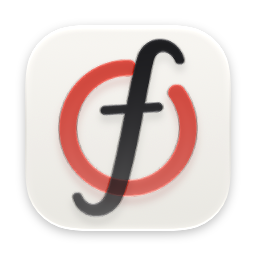
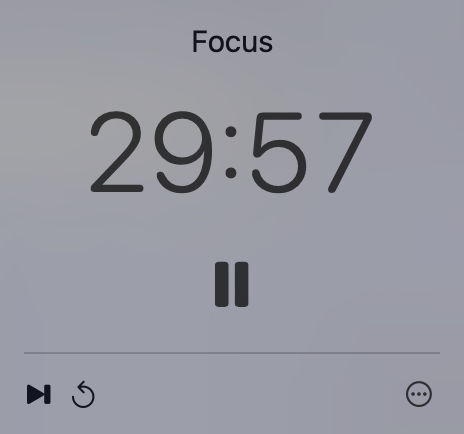

# btmx-focus

A native macOS menu-bar focus timer: 30 minutes of focus, 5 minutes of rest, one click away.



## Install

```sh
brew install bytemux/tap/btmx-focus
```

Or download the DMG from [Releases](https://github.com/bytemux/btmx-focus/releases).
Requires macOS 15 or newer on Apple silicon. The app isn't notarized: the
Homebrew cask clears the quarantine flag for you; after a direct download,
allow the first launch in System Settings → Privacy & Security → Open Anyway.

## Develop

- [Build and run](docs/building.md)
- [Testing](docs/testing.md)
- [Glossary](GLOSSARY.md) and [decisions](docs/adr/)
- [Roadmap](https://github.com/bytemux/btmx-focus/issues)
